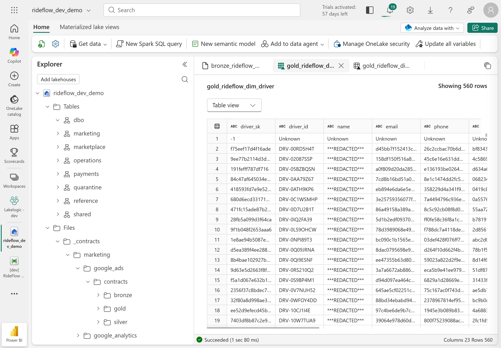
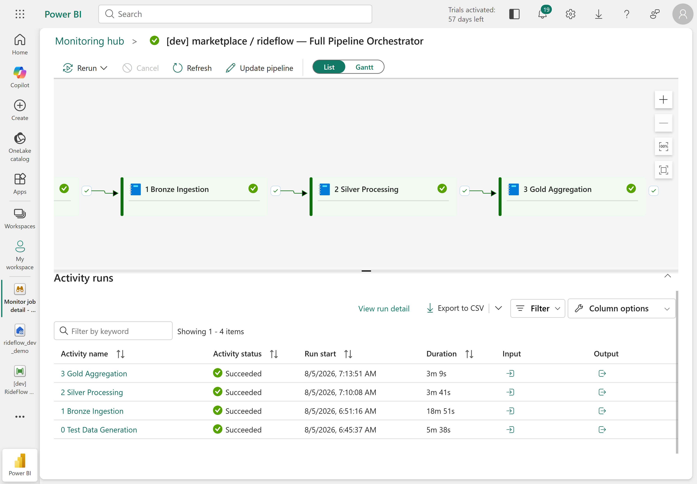
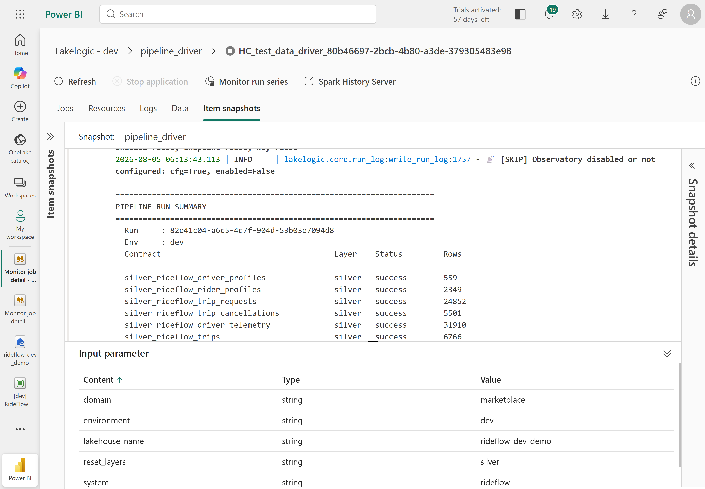

# Multi-Domain Lakehouse on Microsoft Fabric — a Governed Data Mesh Implementation

*One Fabric Lakehouse on OneLake, many domain-owned data products — implementing the principles of a
**data mesh** (domain ownership, data as a product, a self-service platform, and federated
governance) with data contracts, quarantine and quality gates.*

> **Let every team own its data — without losing control of quality, PII or trust.**
> A governed data mesh on Microsoft Fabric: domain teams ship their own Bronze/Silver/Gold data
> products, while one shared layer enforces schema, quality, lineage and PII rules across all of
> them — natively on OneLake, deployed entirely as code (no click-ops), and orchestrated by one
> click.

Run a contract-driven Bronze, Silver and Gold lakehouse on Microsoft Fabric.

This reference project uses [LakeLogic](https://pypi.org/project/lakelogic/) to
apply shared data rules across six business domains. It demonstrates data
contracts, quality gates, quarantine, lineage metadata, service-level checks and
dependency-aware pipelines.

The example company, **RideFlow**, is fictional. It represents a ride-hailing and
food-delivery business.

```text
RideFlow · one Fabric lakehouse (OneLake) · 6 domains · 11 source systems
│
├── Marketplace   (rideflow)
│   ├── Riders & Drivers
│   ├── Trips
│   └── Cancellations
│
├── Payments   (stripe)
│   ├── Charges
│   └── Payouts
│
├── Operations   (checkr · twilio · zendesk)
│   ├── Background checks & driver licences
│   ├── SMS logs
│   └── Support tickets
│
├── Marketing   (google_ads · google_analytics · hubspot · meta_ads)
│   ├── Campaigns & spend
│   ├── App events & sessions
│   └── Email & push
│
├── Reference   (internal)
│   ├── Cities
│   └── FX rates
│
└── Shared   (cross-domain marts)
    └── Products that join across every domain
```

> This is a community reference from the LakeLogic team. It is not an official
> Microsoft product.

## Project status

The RideFlow contracts, test-data generators and LakeLogic controls come from the
existing Databricks reference implementation.

The **Microsoft Fabric deployment and runtime layer is new**, following Fabric and
OneLake conventions. It has been **validated end-to-end on a live Fabric workspace** —
all six domains / eleven systems run green through a single one-click mesh orchestrator.
On trial (FTL64) capacity the mesh runs in bounded parallel (two systems at a time to
stay within the trial's Spark-session limits); a separate max-parallel orchestrator is
included for purchased F-SKU capacity.

See [docs/architecture.md](docs/architecture.md) for the design and current
limitations.

## What this project demonstrates

- **Domain ownership:** each business domain owns its contracts and data products.
- **Shared rules:** domains reuse the same validation, quality and pipeline controls.
- **Quarantine with reasons:** rejected rows are retained with details of the rule
  that failed.
- **Dataset quality gates:** serious data-quality failures can stop the pipeline.
- **Freshness and volume checks:** contracts can define service-level expectations.
- **Cross-domain dependencies:** one data product can declare that it depends on
  another.
- **Gold data models:** contracts can configure models such as SCD Type 2
  dimensions.

## See it in action

Six teams, eleven source systems, one set of rules — running natively on **Microsoft Fabric
and OneLake**, deployed as code and driven by a single pipeline.

🔒 **Auditable governance evidence, by construction.** Every domain gets its own governed schema
in one lakehouse; selected Gold dimensions demonstrate SCD Type 2 history and row-level lineage back
to source, and PII columns are masked by contract — names, emails and phones land `***REDACTED***`
unless a policy says otherwise.



🟢 **Every data product, the same medallion pattern.** Each system runs Bronze → Silver → Gold as
one dependency-aware pipeline — reproducible, re-runnable, and green end-to-end.



📊 **Proof, not hope.** Every run emits a data-quality summary — which contract, which layer, how
many rows accepted — so trust in the data is measured, not assumed.



## How the design maps to Fabric

| Data-mesh need | Microsoft Fabric implementation |
| --- | --- |
| Shared data platform | One schema-enabled Lakehouse |
| Domain boundary | One Lakehouse schema per domain |
| Bronze, Silver and Gold tables | Delta tables in OneLake |
| Landing files, contracts and logs | OneLake Files |
| Processing | Fabric Spark notebooks |
| Deployment | Fabric REST API and OneLake DFS API |
| Orchestration | Notebook runs started by the deployment script |
| Rejected data | A shared `quarantine` schema |

LakeLogic applies the contract rules and runs the data processing. Microsoft
Fabric provides the workspace, OneLake storage, Spark compute, Lakehouse tables,
permissions and notebook runtime.

## Before you start

You need:

- A Microsoft Fabric workspace connected to an active Fabric capacity. A trial
  capacity can be used.
- Permission to create a Lakehouse and run notebooks.
- [Azure CLI](https://learn.microsoft.com/cli/azure/install-azure-cli) installed
  and signed in.
- Python 3.

The deployment can use an existing workspace or create a new one. Creating a
workspace requires a Fabric capacity ID.

## Quick start

### 1. Sign in

```bash
az login
```

### 2. Set the workspace and Lakehouse

Edit [fabric/fabric_variables.yaml](fabric/fabric_variables.yaml):

```yaml
workspace:
  name: "RideFlow Data Mesh"
  capacity_id: ""

lakehouse:
  name: "rideflow_demo"
```

For an **existing workspace**, enter its exact name and leave `capacity_id` empty.

To **create a workspace**, provide the ID of an active Fabric capacity:

```bash
az account get-access-token \
  --resource https://api.fabric.microsoft.com \
  --query accessToken \
  --output tsv
```

You can also find the capacity ID in the Fabric Admin portal under **Capacity
settings**. It is the GUID shown in the capacity page URL.

### 3. Deploy

On Windows PowerShell:

```powershell
.\fabric\deploy\deploy.ps1
```

On macOS or Linux:

```bash
./fabric/deploy/deploy.sh
```

The wrapper installs the small local dependencies required by the deployment
script, then runs it.

To call the Python script directly:

```bash
python -m pip install pyyaml requests
python fabric/deploy/deploy.py
```

## What the deployment does

The deployment:

1. Finds or creates the Fabric workspace.
2. Finds or creates the schema-enabled `rideflow_demo` Lakehouse.
3. uploads the contract registry to `Files/_contracts` in OneLake.
4. Imports and attaches three Fabric notebooks.
5. Creates the domain schemas, quarantine schema, folders and run-log tables.
6. Generates test data for each source system.
7. Runs the Bronze, Silver and Gold pipelines in dependency order.

Bad rows can be sent to quarantine while valid rows continue. Dataset-level
quality gates can stop the run when the configured failure limit is exceeded.

### Useful deployment options

Create the Fabric resources without running the domain pipelines:

```bash
python fabric/deploy/deploy.py --setup-only
```

Run one domain and source system:

```bash
python fabric/deploy/deploy.py --domain marketplace/rideflow
```

## Check the result

Run the following in a Fabric notebook or the Lakehouse SQL analytics endpoint:

```sql
SELECT *
FROM rideflow_demo.marketplace.gold_rideflow_fact_trip_daily_kpis
LIMIT 20;
```

List the tables containing rejected rows:

```sql
SHOW TABLES IN rideflow_demo.quarantine;
```

Quarantined records include `_lakelogic_errors`, which explains why each record
failed.

## Repository contents

```text
domains_rideflow/
  Contracts and configuration owned by each RideFlow domain

fabric/
  fabric_variables.yaml   Workspace and Lakehouse settings
  notebooks/              Setup, test-data and pipeline notebooks
  deploy/                 PowerShell, shell and Python deployment tools
  pipelines/              Optional Fabric Data Pipeline definition

docs/
  Architecture and Fabric mapping notes

scripts/
  Static release checks
```

The contract hierarchy is:

```text
domain defaults -> system defaults -> individual data contract
```

More specific settings override inherited defaults. This lets teams share common
rules without copying the same configuration into every contract.

## Fabric and Databricks

This repository is the Microsoft Fabric sibling of
[`lakelogic-databricks-data-mesh`](https://github.com/LakeLogic/lakelogic-databricks-data-mesh).

The business domains and contract model are shared. The deployment layer changes
because each platform provides storage, catalogues, compute, permissions and
orchestration differently.

| Databricks | Microsoft Fabric |
| --- | --- |
| Unity Catalog catalog | Schema-enabled Lakehouse |
| Unity Catalog schema | Lakehouse schema |
| Unity Catalog Volumes | OneLake Files |
| Managed Delta tables | OneLake Delta tables |
| Databricks Spark | Fabric Spark |
| Databricks Asset Bundles | Fabric REST and OneLake APIs |
| Databricks Jobs | Fabric notebook runs or Data Pipelines |

## Learn more

- [Architecture and implementation notes](docs/architecture.md)
- [LakeLogic documentation](https://lakelogic.github.io/LakeLogic/)
- [LakeLogic on PyPI](https://pypi.org/project/lakelogic/)

Install the framework:

```bash
pip install lakelogic
```
