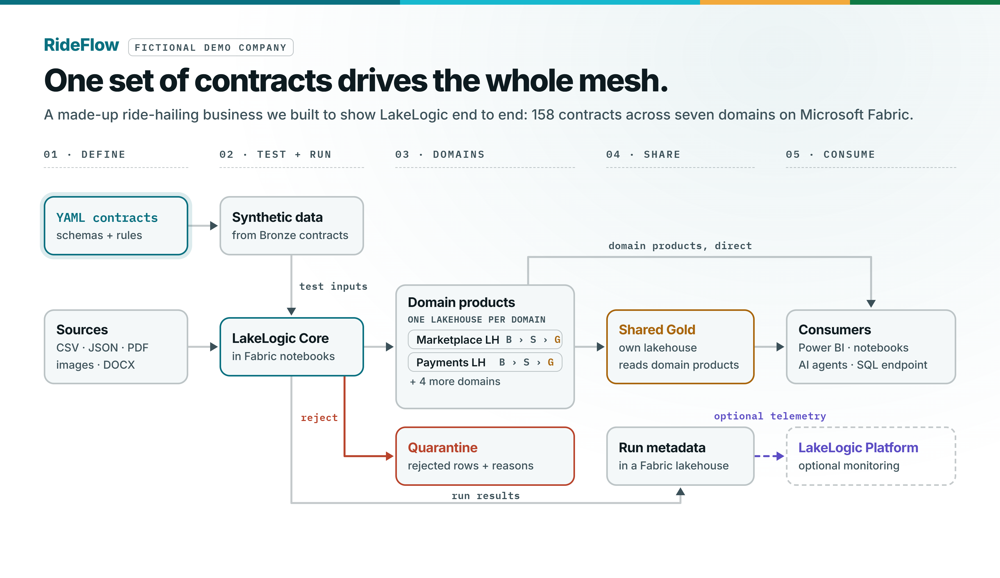
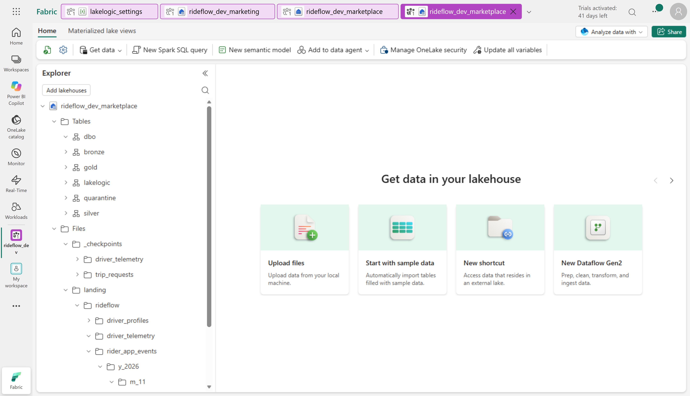
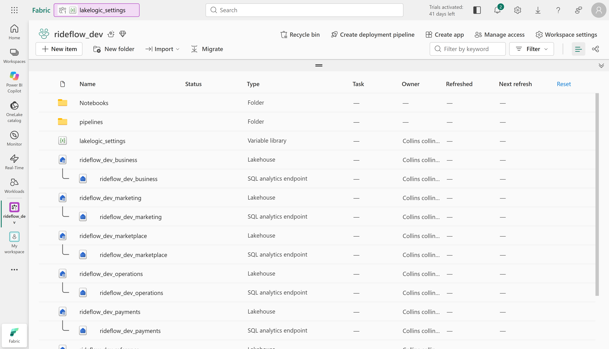
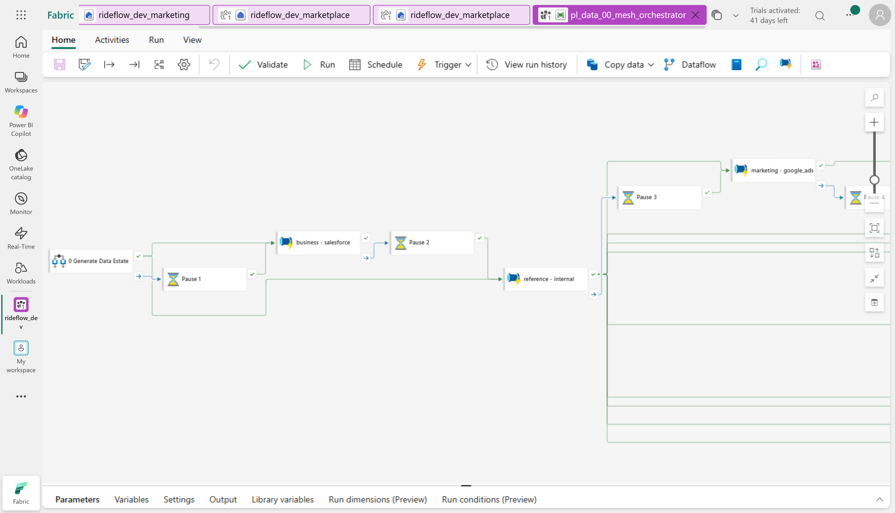
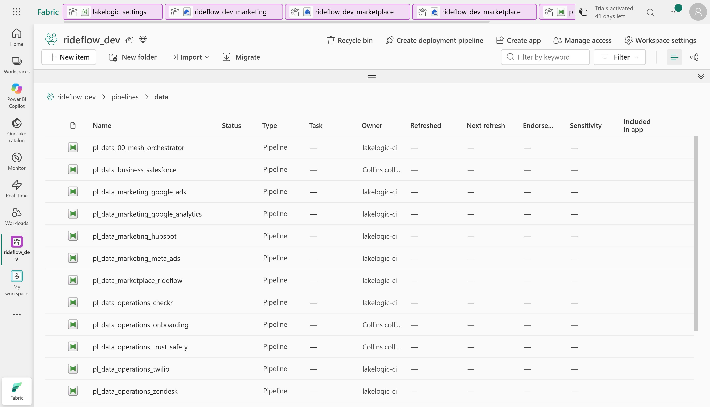
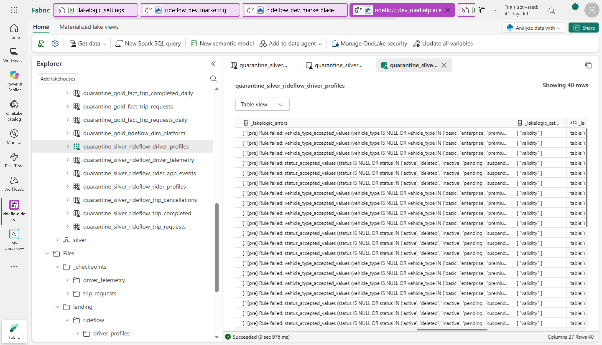

# RideFlow: a governed data mesh on Microsoft Fabric

**Build a decentralised Fabric lakehouse with shared governance.**

Businesses need data they can trust, but ingestion, transformation and quality checks are often implemented differently across teams. Ownership is unclear, governance is inconsistent, and every new source adds more custom code to maintain. **LakeLogic Core standardises ingestion, transformation, validation and materialisation through executable data contracts**, giving domain teams a consistent way to deliver governed data products.

RideFlow demonstrates this in a decentralised Microsoft Fabric lakehouse: CSV and JSON exports alongside PDFs, images and Word documents, processed through Fabric Spark notebooks and Data Pipelines.

This synthetic reference project uses **OneLake, Delta Lake, Fabric Data Pipelines and a Variable Library**, with **158 contracts across seven domains** and Bronze, Silver and Gold layers. The contracts are the same ones that run in the [Databricks reference project](https://github.com/LakeLogic/lakelogic-rideflow-databricks-governed-lakehouse); only the platform layer differs.

> RideFlow is a fictional business using synthetic data. This is a community reference from the LakeLogic team, not an official Microsoft product.

## Architecture

<picture>
  <source media="(prefers-color-scheme: dark)" srcset="docs/images/rideflow_architecture_dark.png">
  
</picture>

Domains maintain their own contract trees and publish products in separate lakehouses (`rideflow_dev_<domain>`). Shared Gold products consume outputs across domain boundaries; reusable notebooks and deployment tooling provide the common platform.



*RideFlow reference project · synthetic data. In Fabric after a run: the Marketplace lakehouse, with its own layer, quarantine and run-log schemas and its landing files.*

<details>
<summary>The workspace: one lakehouse per domain</summary>



*RideFlow reference project · synthetic data. Every domain lakehouse comes with its SQL analytics endpoint.*

</details>

**Why this is a mesh pattern:** domain-local definitions, consumer-facing products, reusable platform execution and shared governance conventions. Lakehouse separation and declared owners do not automatically establish team permissions; configure workspace roles and OneLake access explicitly.

Domains: Marketplace, Payments, Operations, Marketing, Business, Reference and Shared. The contract tree is authoritative. [Explore the architecture](docs/architecture.md)

| Path | Contents |
| --- | --- |
| `contracts/` | Domain and system registries plus 158 contracts, identical to Databricks |
| `platform/fabric/notebooks/` | Setup, pipeline driver, test data, SLO checks, maintenance, erasure and retention |
| `platform/fabric/pipelines/` | One pipeline per system, the mesh orchestrator and admin, monitor, privacy and test pipelines |
| `platform/fabric/variables/` | `lakelogic_settings` Variable Library, with a `prod` value set |
| `platform/fabric/deploy.py` | Creates lakehouses, uploads contracts and deploys every item through the Fabric REST API |

## What you can learn

| Your focus | What to inspect |
| --- | --- |
| Architecture | Domain boundaries, inherited settings and cross-domain dependencies |
| Engineering | Contract-driven ingestion, transformations, incremental processing and orchestration |
| Analytics | Gold facts, dimensions and a shared city/day marketplace-health product |
| Governance | Ownership, quality rules, privacy operations, service expectations and their evidence |
| Platform delivery | Fabric Git-format items, Variable Library value sets and repository validation |

## Run the example

Use an isolated demo workspace. You need an authenticated Azure CLI (`az login`), a Fabric capacity (Trial works) and permission to create items in the workspace.

**Before deploying:** review the [deployment target](platform/fabric/deploy/deployment_targets.json) and replace environment-specific workspace and lakehouse names. Capacity usage incurs costs; synthetic inputs need no live source-system credentials.

**Run independently or connect to LakeLogic Platform.** The pipelines can run without a LakeLogic Platform connection. Inspect pipeline run metadata and quality results in the LakeLogic tables within your lakehouses. If you have a LakeLogic Platform workspace, set the telemetry endpoint and supply the key at run time or from Key Vault to also send run metadata to the platform. Leave the endpoint empty to run independently.

```bash
python platform/fabric/deploy.py --workspace rideflow_dev --lakehouse rideflow_dev
```

Add `--domain <domain>/<system>` to deploy a single system, or `--setup-only` to create the domain lakehouses, upload contracts and import notebooks without building pipelines. `--lakehouse` is the prefix of each domain's `rideflow_dev_<domain>` lakehouse.

Then run **`pl_data_00_mesh_orchestrator`** in the workspace.



*RideFlow reference project · synthetic data. The orchestrator runs each system's pipeline in dependency order: Business and Reference first, then the systems that read them.*

<details>
<summary>One pipeline per system, and a system run</summary>



*RideFlow reference project · synthetic data. Data pipelines in the workspace's `pipelines/data` folder.*


*RideFlow reference project · synthetic data. One system's Bronze, Silver and Gold run.*

</details>

**Capacity.** Systems run one at a time, in dependency order, so the mesh fits a Trial capacity's Spark-session limits. Business and Reference run first, then the systems that read them.

**Test without live sources.** `pl_test_synthetic_seed` generates synthetic inputs from Bronze contracts, including PDFs, images and Word documents. Synthetic rows carry a `_synthetic` marker through Silver and Gold.

**Production stops synthetic data.** Activate the `prod` value set of `lakelogic_settings` in a production workspace. It sets `synthetic_data` to `false`, and the seed refuses to run.

**Check parameters before running or rerunning:** demo pipelines can reset selected layers, and some products overwrite their outputs. Checkpoints and seed settings also affect reruns. Do not run reset-oriented pipelines against production tables.

## Follow one data product

**How do trip demand, completion and revenue vary by city and day?**

Follow Marketplace requests and completed trips, join Payments charges, and inspect the Shared marketplace-health mart. Its grain is one row per `(kpi_date, city_code)`. Inspect accepted and rejected rows alongside run status, not just whether the pipeline finished.

## Evidence and limitations



*RideFlow reference project · synthetic data. Rows held in `quarantine_silver_rideflow_driver_profiles`, each with the rule it broke and its category. Use your deployment's tables and logs to verify the revision you run.*

<details>
<summary>Run summary with quality results</summary>


</details>

- Configured row failures may enter quarantine; dataset gates and execution errors can stop a run.
- Contract definitions and CI checks are distinct from successful Fabric execution. Use dated runs and output checks for the exact revision deployed.
- Synthetic tests do not establish production performance, security or business correctness. Retention and erasure pipelines do not establish end-to-end GDPR compliance.
- Review permissions, realistic SLOs, recovery and operating costs before production use.

## Explore further

[Contract specification](https://github.com/LakeLogic/open-lakehouse-contract) | [LakeLogic Core runtime](https://github.com/LakeLogic/LakeLogic) | [Databricks reference project](https://github.com/LakeLogic/lakelogic-rideflow-databricks-governed-lakehouse) | [Architecture reference](docs/architecture.md)

<sub>Platform layer generated by LakeLogic Lakehouse Studio from the Databricks reference contracts.</sub>
