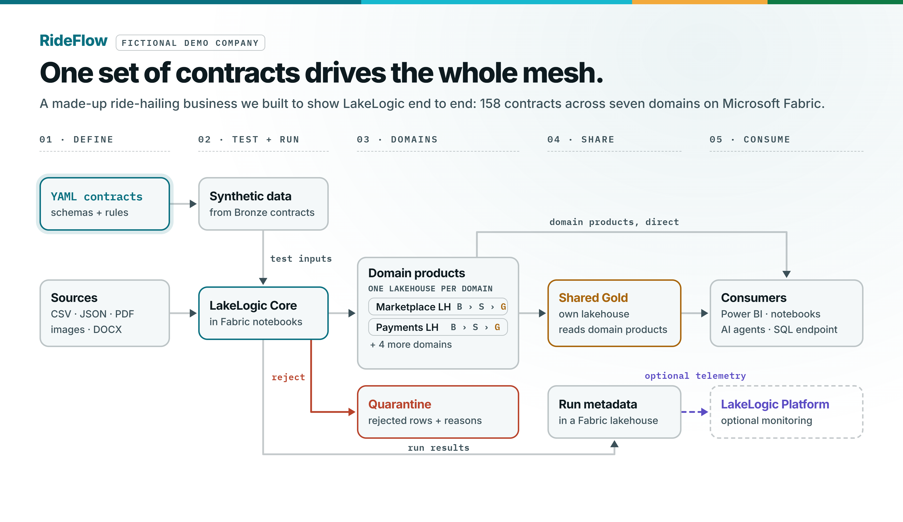
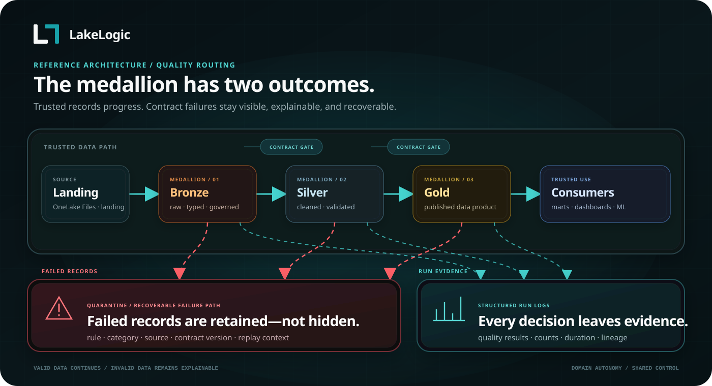
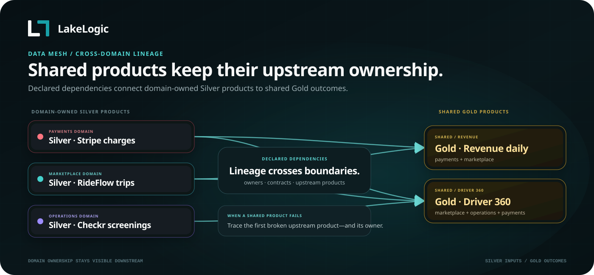

# Architecture and reference

[Back to the quickstart](../README.md)

Detailed examples and repository layout for the RideFlow reference lakehouse on Microsoft Fabric.

> Current inventory: 158 contracts across seven domains, including Business/Salesforce. There are 14 source-system trees plus the Shared registry. The contracts are identical to the [Databricks reference project](https://github.com/LakeLogic/lakelogic-rideflow-databricks-governed-lakehouse); only `_system.yaml` platform settings and `platform/fabric/` differ.

## Domain boundaries

```text
RideFlow · one Fabric workspace (OneLake) · 7 domains · 14 source systems plus Shared
Source-processing domains use the medallion pattern — Bronze (raw, all-string, schema-flexible) → Silver (typed, cleaned, transformed, validated) → Gold (products)
│
├── Marketplace   (rideflow)                          ← shown expanded as the example
│   ├── Bronze   raw · all-string · schema-flexible (evolves, keeps everything)
│   │     driver_profiles · rider_profiles · driver_telemetry · rider_app_events
│   │     trip_requests · trip_completed · trip_cancellations
│   ├── Silver   typed, cleaned, deduped, transformed, validated
│   │     driver_profiles · rider_profiles · trips (joined) · trip_requests
│   │     driver_telemetry · rider_app_events
│   └── Gold   business products
│         dim_driver · dim_rider (SCD2) · code dims (trip_type, vehicle_type, …)
│         fact_trip_completed · fact_trip_requests · fact_trip_cancellations
│         fact_driver_telemetry · fact_rider_app_events
│
├── Payments     (stripe · driver_expenses)                        →  Bronze → Silver → Gold
├── Operations   (checkr · onboarding · trust_safety · twilio · zendesk)  →  Bronze → Silver → Gold
├── Marketing    (google_ads · google_analytics · hubspot · meta_ads)     →  Bronze → Silver → Gold
├── Business     (salesforce)                                      →  Bronze → Silver → Gold
├── Reference    (internal)      →  Bronze → Silver → Gold   ·  cities, fx rates
└── Shared       (cross-domain marts)   →  Gold   ·  products that join every domain
```

<picture>
  <source media="(prefers-color-scheme: dark)" srcset="images/rideflow_architecture_dark.png">
  
</picture>

Source-processing domains own their Bronze, Silver and Gold definitions. Shared settings
are inherited from `_domain.yaml` and `_system.yaml`; each contract keeps its
dataset-specific rules beside the team that understands the data. Shared Gold
products read other domains' outputs directly and own no sources.

The 158 contracts cover CSV, JSON, PDF, image and Word input, external Python logic,
cross-domain Gold products, row-level lineage tags, freshness and volume SLOs, and SCD
Type 2 dimensions (tracked columns, surrogate keys, effective dates, current-version
flags and an unknown member).

## Data flow



*Contracts govern every layer. Row failures can enter quarantine while valid rows
continue; dataset gates can still stop an unsafe run.*

Source files land in each domain lakehouse under `Files/landing/<system>`. Bronze keeps
them raw and all-string, Silver types, cleans and validates them, and Gold builds the
products. Quarantine is a failure path, not another layer: a rejected row keeps the
rule it failed and its source context.

## Dependency execution

Contracts declare `depends_on` edges. LakeLogic builds the graph and processes products
in dependency order, including dependencies within one layer.

Each system has one Data Pipeline (`pl_data_<domain>_<system>`) that runs its Bronze,
Silver and Gold stages. `pl_data_00_mesh_orchestrator` runs those pipelines one at a
time in dependency order: Business and Reference first, then the systems that read
them, then Shared. Running one at a time keeps the mesh within a Trial capacity's Spark
session limits. Synthetic seeding is separate: run `pl_test_synthetic_seed` first when
there are no landing files.



*The shared revenue and driver products depend on data owned by Payments,
Marketplace and Operations.*

## Deployed resources

`platform/fabric/deploy.py` creates these through the Fabric REST API. `--lakehouse` is
a prefix: `--lakehouse rideflow_dev` creates `rideflow_dev_<domain>`. There is no
shared platform lakehouse.

```text
One schema-enabled lakehouse per domain: rideflow_dev_<domain>
├── Files/_contracts     That domain's contracts, uploaded by deploy.py
├── Files/landing        Inbound source files, one folder per system
├── Files/wheels         The LakeLogic wheel, when deployed with --wheel
├── Files/lakelogic_logs Pipeline run logs
├── bronze               Bronze Delta tables
├── silver               Silver Delta tables
├── gold                 Gold Delta tables
├── quarantine           Contract-failing rows
└── lakelogic            Run log, SLO results, retention and erasure records

Domains: marketplace, marketing, payments, operations, business,
         reference (shared lookups and conformed dimensions),
         shared (cross-domain marts; gold only)

Workspace items: 7 notebooks, 22 Data Pipelines, 1 Variable Library
```

Every notebook starts with a `%%configure` cell that sets its default lakehouse from the
`default_lakehouse` parameter, so each pipeline run works in its own domain's lakehouse.
Notebooks are attached to the first domain's lakehouse for interactive use.

`--setup-only` creates the lakehouses, uploads contracts and imports notebooks and the
Variable Library, without building pipelines. `--domain <domain>/<system>` builds one
system's pipeline.

## Configuration

The deployment target in `platform/fabric/deploy/deployment_targets.json` names the
workspace, the lakehouse prefix and the LakeLogic version or wheel.

The `lakelogic_settings` Variable Library holds settings that change by environment.
Its default value set allows synthetic data. The `prod` value set sets `synthetic_data`
to `false`, and the synthetic seed then stops before writing anything. Activate a value
set per workspace in the workspace settings. Two limits apply: the seed only refuses
when the `prod` value set is active, and if the Variable Library is missing the seed
runs. Activating `prod` turns off synthetic data and nothing else; it does not make a
workspace production ready.

## Operational evidence

**Evidence stays in your lakehouses.** Each domain lakehouse records its own runs:

- `lakelogic.lakelogic_run_log`: one row per contract run, with counts, status and timings
- `lakelogic.lakelogic_slo_checks`: freshness and row-count results from `pl_monitor_slo`
- `quarantine.*`: rejected rows, each with the rule it failed and its category
- `Files/lakelogic_logs`: the pipeline driver's run logs

**Reporting to LakeLogic Platform is optional.** The pipeline driver sends run metadata
only when its `telemetry_endpoint` parameter is set and a key is supplied, either as the
`telemetry_key` run parameter or from Key Vault (`telemetry_key_vault` and
`telemetry_key_secret`). With the endpoint empty, nothing leaves the workspace. Reporting
adds a copy; the lakehouse tables above remain the record.

## Limitations

Keep these apart when you assess the project:

- **Deployed structure** shows the items exist. It does not show they ran.
- **Configured safeguards** (quality rules, quarantine, dataset gates, the synthetic-data
  switch, erasure dry runs) describe what a run will enforce, given the prerequisites above.
- **Recorded runs** are the evidence: the run log, quarantine tables and pipeline history
  for the revision you deployed.

Synthetic runs do not establish production performance, security or business
correctness. Retention and erasure pipelines do not establish end-to-end GDPR compliance.
Lakehouse separation and declared owners do not grant permissions; configure workspace
roles and OneLake access yourself. Review SLOs, recovery and costs before production use.

## Repository layout

The repository keeps reusable data-product definitions separate from the code
that deploys and runs them on Fabric:

```text
.github/
  workflows/validate.yml      CI validation for contracts and Python files
contracts/                    Domain-owned contract trees
  marketing/                  Google Ads, Google Analytics, HubSpot, and Meta Ads
    _domain.yaml              Domain ownership, SLOs, compliance and retention
    <system>/
      _system.yaml            System defaults, Fabric platform settings and contract registry
      contracts/
        bronze/               Source-aligned ingestion contracts
        silver/               Cleaned and conformed data products
        gold/                 Business-facing facts, dimensions, and aggregates
  business/                   Salesforce accounts, contacts, opportunities, cases and contracts
  marketplace/                Trips, riders, drivers, telemetry, and pricing
  operations/                 Screening, onboarding, trust and safety, support
  payments/                   Charges, refunds, payouts, and driver expenses
  reference/                  Shared lookups and conformed reference data
  shared/                     Cross-domain products and marts
platform/fabric/
  deploy.py                   Creates lakehouses, uploads contracts, deploys items via the Fabric REST API
  deploy/deployment_targets.json  Workspace, lakehouse prefix and engine version per environment
  notebooks/                  Fabric Git-format notebooks
    nb_00_setup               Domain lakehouse schemas and contract staging
    nb_pipeline_driver        Registry-driven Bronze, Silver, and Gold runner
    nb_test_data_driver       Synthetic landing-data generator
    nb_slo_checks             Service-level (freshness / row-count) checks
    nb_maintenance_optimize   Delta OPTIMIZE + VACUUM
    nb_compliance_retention_check  Read-only retention check
    nb_compliance_erasure     Data-subject erasure tooling, dry run by default
  pipelines/                  Data Pipelines, grouped as LakeLogic Lakehouse Studio renders them
    admin/                    pl_admin_setup, pl_admin_maintenance
    data/                     pl_data_00_mesh_orchestrator, pl_data_<domain>_<system>
    monitor/                  pl_monitor_slo
    privacy/                  pl_privacy_retention, pl_privacy_erasure
    test/                     pl_test_synthetic_seed
  variables/                  lakelogic_settings Variable Library (default and prod value sets)
  olc/                        Contract validation
  tests/                      Project structure tests
docs/                         Architecture reference
  images/                     README screenshots and architecture diagrams
scripts/
  validate_release.py         Static checks used locally and in CI
README.md                     Public overview and quickstart
LICENSE                       Apache 2.0 licence
```

`contracts/` contains the portable business definitions. `platform/fabric/`
contains the platform-specific deployment and execution code. This boundary is
intentional: a domain team can review its contracts without needing to understand
the Fabric items, while the platform team can change deployment code
without moving business rules into notebooks. The same `contracts/` tree runs on
Databricks with a different `platform/` folder.
