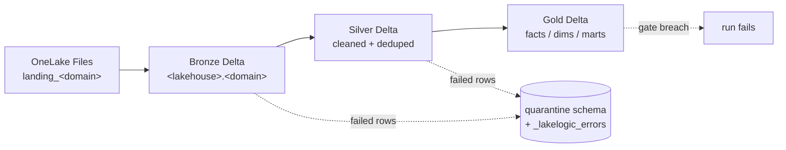
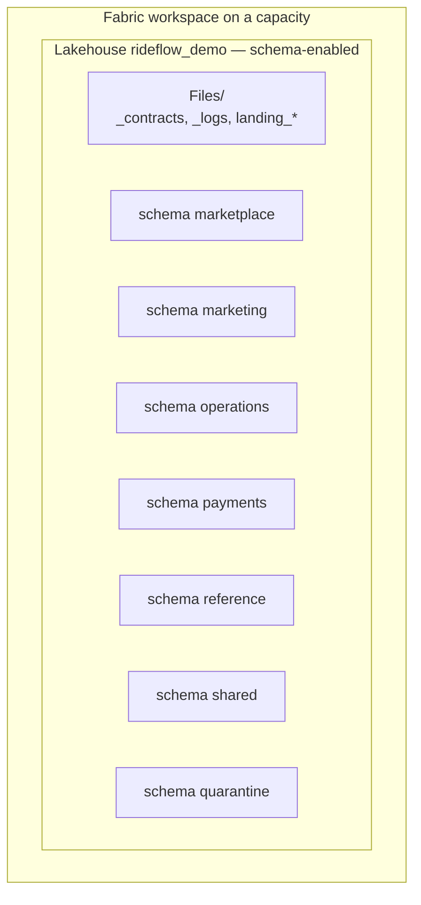

# Architecture — LakeLogic Data Mesh on Microsoft Fabric

This repo is the Microsoft Fabric sibling of the Databricks reference
`lakelogic-databricks-data-mesh`. The **business definitions are identical** — the
same `domains_rideflow/` contract trees — so a domain team can move between the two
platforms without rewriting contracts. Only the deployment and runtime layer differs.

## Medallion + quarantine

Contracts govern every layer. Row failures enter the `quarantine` schema with the
failing rule and source context; dataset-level quality gates can still stop an
unsafe run. Structured run logs (`<domain>._pipeline_run_log`) record what passed,
what failed, and how long each contract took.

## Fabric object model

One schema-enabled Lakehouse is the "catalog". Each domain owns a **schema**; the
`quarantine` schema holds rejected rows. Landing data, the staged contract
registry, and run logs live in that lakehouse's **OneLake Files**, mounted at
`/lakehouse/default/Files/` inside a Fabric Spark notebook — the direct analog of
Unity Catalog Volumes.

## Why LakeLogic runs unchanged

LakeLogic already ships a Fabric-aware catalog resolver
(`engines/catalog_resolver.py`, `platform="fabric"` → OneLake `abfss://…`). In this
repo we use the simpler equivalent: the pipeline runs in `uc` storage mode, and
because a schema-enabled Fabric lakehouse exposes `lakehouse.schema.table` to Spark
SQL, the contracts' 3-part table names (`{catalog}.{domain}.<table>`) resolve
natively against the attached lakehouse. The only per-system change from the
Databricks repo is in `_system.yaml`:

| `storage.` key | Databricks | Fabric |
| --- | --- | --- |
| `landing_root` | `/Volumes/{catalog}/nondelta/landing_{domain}/{system}` | `/lakehouse/default/Files/landing_{domain}/{system}` |
| `log_root` | `/Volumes/{catalog}/nondelta/_logs` | `/lakehouse/default/Files/_logs` |
| `contract_root` | `/Workspace/Shared/data_platform/domains/{domain}/{system}` | `/lakehouse/default/Files/_contracts/{domain}/{system}` |
| `domain_catalog` | `` `{catalog}`.{domain} `` | unchanged (catalog = lakehouse name) |

## Deployment flow

`fabric/deploy/deploy.py` uses two Azure-CLI tokens — the Fabric REST API
(`https://api.fabric.microsoft.com`) and OneLake storage
(`https://storage.azure.com`):

1. **Provision** — resolve/create the workspace (on the configured capacity) and the
   schema-enabled lakehouse.
2. **Upload** — push `domains_rideflow/` into OneLake `Files/_contracts` via the DFS
   API (create → append → flush).
3. **Import** — convert each cell-delimited `.py` notebook to `.ipynb` and create it
   with the lakehouse attached as default.
4. **Run** — `00_setup`, then per system `test_data_driver` → `pipeline_driver`.

An optional Fabric **Data Pipeline** can replace step 4 for scheduled runs; the
per-notebook run approach keeps the demo dependency-light.

## Validation status

The contract layer is the certified, portable LakeLogic model (same as the
Databricks repo, which is validated end-to-end on a live workspace). The Fabric
runtime/deploy layer here is **new and pending a first live run** on a Fabric
capacity — the OneLake path and schema-enabled-lakehouse mapping follow Fabric
conventions but should be confirmed against a real workspace and iterated if the
Fabric Spark session resolves any path differently.
